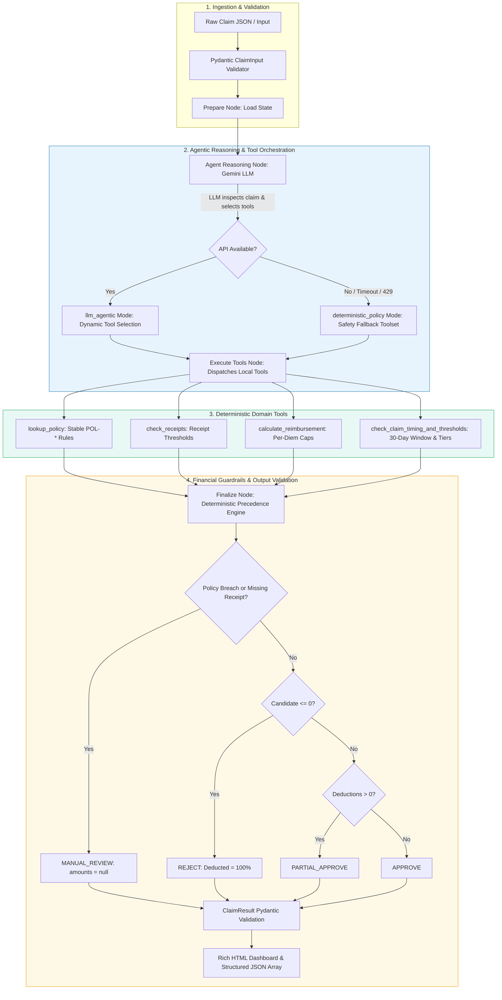

# AI Travel Reimbursement Approval Agent

[](https://www.python.org/downloads/)
[](https://github.com/langchain-ai/langgraph)
[](https://docs.pydantic.dev/)
[](https://opensource.org/licenses/MIT)

> An enterprise-grade, agentic AI solution that evaluates corporate travel reimbursement claims against policy limits, receipt requirements, submission timeliness, and approval matrices. Designed with **LangGraph agentic tool-calling**, **Gemini 3.5 LLM reasoning**, and **strict mathematical/policy guardrails** ensuring zero financial hallucination.

---

## Table of Contents

- [Business Problem & Overview](#business-problem--overview)
- [System Architecture & Workflow](#system-architecture--workflow)
- [Policy Rules Engine](#policy-rules-engine)
- [Guardrails & Zero-Hallucination Design](#guardrails--zero-hallucination-design)
- [Input / Output Data Contracts](#input--output-data-contracts)
- [Quickstart & Execution](#quickstart--execution)
- [Results Dashboard & Outcomes](#results-dashboard--outcomes)
- [Design Trade-offs & Engineering Decisions](#design-trade-offs--engineering-decisions)

---

## Business Problem & Overview

Processing corporate travel and expense (T&E) claims manually is error-prone, labor-intensive, and introduces compliance bottlenecks. However, relying purely on unconstrained Large Language Models (LLMs) to perform math and make financial decisions leads to hallucinations, non-deterministic rounding errors, and un-auditable payouts.

This project delivers an **agentic AI solution**:
1. An **LLM Agent (Google Gemini)** inspects unstructured expense descriptions and autonomously determines what compliance tools must be invoked.
2. **Deterministic Domain Tools** execute item-level per-diem caps using Python's arbitrary-precision `Decimal` arithmetic.
3. **Deterministic Guardrails** enforce company approval hierarchies and route exceptions, missing receipts, and policy breaches to `MANUAL_REVIEW`.
4. **Seamless Dual-Mode Fallback** guarantees 100% operational uptime even if the LLM encounters transient timeouts or missing API credentials.

---

## System Architecture & Workflow

The architecture is implemented as an auditable **LangGraph StateGraph** consisting of 4 distinct operational nodes:



### End-to-End Node Responsibilities

| Node | Name | Responsibility |
|---|---|---|
| **Node 1** | `prepare_node` | Validates intake against Pydantic `ClaimInput` schema, normalizes dates and line items, initializes the graph state. |
| **Node 2** | `agent_reasoning_node` | Uses Gemini (`gemini-3.5-flash-lite`) to inspect the claim context and generate an agentic audit plan specifying which compliance tools to execute. |
| **Node 3** | `execute_tools_node` | Dispatches the chosen tools deterministically. Ensures mandatory safety tools are executed even if the agent selects a partial subset. |
| **Node 4** | `finalize_node` | Applies deterministic financial math (`Decimal`), evaluates approval tier thresholds, maps policy references, and constructs both the public `ClaimResult` and internal audit trail. |

---

## Policy Rules Engine

The agent evaluates claims against a standardized policy registry:

| Policy ID | Category | Rule & Operational Constraint |
|---|---|---|
| **POL-CAT-01** | Category Eligibility | Economy airfare, lodging, meals, ground transport, and conference fees are reimbursable with documented business purpose. |
| **POL-CAT-02** | Ineligible Items | Spa, minibar, gym, entertainment, personal shopping, fines, and penalties are deducted in full (\$0 reimbursement). |
| **POL-PD-01** | Per-Diem Cap | Meals: Maximum **\$75/day**. Excess is deducted. |
| **POL-PD-02** | Per-Diem Cap | Lodging: Maximum **\$200/night**. Excess is deducted. |
| **POL-PD-03** | Per-Diem Cap | Ground Transport: Maximum **\$50/day**. Excess is deducted. |
| **POL-AIR-01** | Travel Class | Only **Economy** is reimbursable. Business/First-class airfare is an exception routing to `MANUAL_REVIEW`. |
| **POL-RCT-01** | Documentation | All line items > **\$25** require an itemized receipt; Airfare and Lodging always require receipts regardless of amount. |
| **POL-RCT-02** | Missing Evidence | Missing required receipts must **never** be silently rejected; the claim is routed to `MANUAL_REVIEW`. |
| **POL-APR-01** | Approval Matrix | Total reimbursable ≤ **\$500**: Agent auto-approval tier. |
| **POL-APR-02** | Approval Matrix | Total reimbursable > **\$500** and ≤ **\$2,000**: Manager approval tier (recommendation is `APPROVE` when fully compliant). |
| **POL-APR-03** | Approval Matrix | Total reimbursable > **\$2,000**: Director approval required; routes to `MANUAL_REVIEW`. |
| **POL-TIME-01**| Timeliness | Claims must be submitted within **30 days** of expense date; late claims route to `MANUAL_REVIEW`. |

---

## Guardrails & Zero-Hallucination Design

Financial systems require deterministic guarantees. The architecture establishes three critical guardrails:

1. **Mathematical Precision via `Decimal`:**
   All monetary calculations strictly use Python's `decimal.Decimal` with `ROUND_HALF_UP` quantization to `0.01`. Floating-point binary inaccuracies (`0.1 + 0.2 != 0.3`) are completely eliminated.
2. **Amount Semantics for `MANUAL_REVIEW`:**
   In accordance with accounting standards, when a claim routes to `MANUAL_REVIEW`, its public financial fields (`approved_amount` and `deducted_amount`) **must be `null`**. Candidate calculations are preserved strictly within internal audit metadata and are never exposed as authorized disbursements.
3. **Policy-Grounded Explanation Filter:**
   The LLM agent's rationale is cross-referenced against the policy tool's actual output. If the model attempts to cite hallucinated policy clauses not returned by `lookup_policy`, the guardrail rejects the citation.

---

## Input / Output Data Contracts

### 1. Ingestion Contract (`ClaimInput`)

Strict Pydantic model (`extra="forbid"`, `strict=True`) requiring:
- `claim_id` (str), `employee` (str), `business_purpose` (str), `business_purpose_documented` (bool)
- `trip_start` (ISO 8601 YYYY-MM-DD), `trip_end` (ISO 8601), `submitted_date` (ISO 8601)
- `line_items`: Array of `LineItem` models containing category, description, amount (ge=0), receipt flags, and optional quantities/units.

### 2. Public Result Contract (`ClaimResult`)

Every claim produces a validated JSON object with **exactly 9 fields**:

```json
{
  "claim_id": "CLM-001",
  "decision": "APPROVE",
  "approved_amount": 1110.00,
  "deducted_amount": 0.00,
  "missing_docs": [],
  "policy_refs": [
    "POL-AIR-01",
    "POL-APR-02",
    "POL-CAT-01",
    "POL-PD-01",
    "POL-PD-02",
    "POL-RCT-01",
    "POL-TIME-01"
  ],
  "confidence": 0.98,
  "explanation": "All claimed items meet the supplied policy checks. Candidate reimbursement is $1110.00. This is the manager approval tier (POL-APR-02); the recommendation is APPROVE.",
  "tools_used": [
    "lookup_policy",
    "check_receipts",
    "calculate_reimbursement",
    "check_claim_timing_and_thresholds"
  ]
}
```

---

## Quickstart & Execution

### Prerequisites

- Python 3.10+
- Jupyter Notebook / JupyterLab or VSCode Jupyter extension

### 1. Installation

```bash
# Clone the repository
git clone <your-repo-url>
cd "Travel Reimbursement Approval Agent"

# Install core dependencies
pip install "langgraph>=1.0" "pydantic>=2.0" "python-dotenv>=1.0" "google-genai>=1.0"
```

### 2. Environment Configuration

Create or update `.env` in the root directory:

```env
# Optional: Gemini API key for active LLM tool reasoning
GOOGLE_API_KEY=your_gemini_api_key_here

# Agent Configuration (defaults)
GEMINI_MODEL=gemini-3.5-flash-lite
LLM_TIMEOUT_SECONDS=10
RUN_LLM_AGENT=true
MAX_CONCURRENT_CLAIMS=2
```

> **Note:** If `GOOGLE_API_KEY` is omitted, the agent seamlessly operates in `deterministic_policy` fallback mode with zero network dependencies.

### 3. Running the Notebook

Open and run **`travel_reimbursement_agent.ipynb`** top-to-bottom.

### 4. Running the Smoke Test Suite

Verify all cells, graph executions, Pydantic schemas, and financial totals without launching a notebook server:

```bash
python tests/smoke_test_notebook.py
```

---

## Results Dashboard & Outcomes

Evaluation of the 5 test claims:

| Claim ID | Employee & Context | Claimed | Decision | Approved | Deducted | Reason / Policy Trigger |
|---|---|---|---|---|---|---|
| **CLM-001** | A. Rivera (2-day Conference) | \$1,110.00 | **`APPROVE`** | \$1,110.00 | \$0.00 | Compliant across all items; manager tier (`POL-APR-02`). |
| **CLM-002** | B. Osei (Weekend hotel stay) | \$380.00 | **`REJECT`** | \$0.00 | \$380.00 | Spa & minibar items are ineligible (`POL-CAT-02`). |
| **CLM-003** | C. Nakamura (Client visit) | \$940.00 | **`PARTIAL_APPROVE`** | \$840.00 | \$100.00 | Hotel \$250/night exceeds \$200 cap (`POL-PD-02`); \$100 deducted. |
| **CLM-004** | D. Fischer (Intl vendor meeting) | \$3,000.00 | **`MANUAL_REVIEW`** | `null` | `null` | Business-class airfare (`POL-AIR-01`), missing lodging receipt (`POL-RCT-02`), and >\$2,000 threshold (`POL-APR-03`). |
| **CLM-005** | E. Haddad (Client dinner) | \$220.00 | **`MANUAL_REVIEW`** | `null` | `null` | Meal line >\$25 without itemized receipt (`POL-RCT-01/02`). |

### Financial Aggregate Breakdown

- **Total Recommended Approved:** **\$1,950.00**
- **Total Recommended Deductions:** **\$480.00**
- **Total Pending Manual Review:** **\$3,220.00** *(strictly quarantined from approved disbursements)*

---

## Design Trade-offs & Engineering Decisions

1. **Why not let the LLM calculate reimbursement amounts directly?**
   LLMs are probabilistic token predictors, not mathematical engines. Floating-point errors and rounding drifts are unacceptable in financial accounting. The LLM functions as the cognitive agent that selects tools; deterministic Python functions execute all calculations.
2. **Why require `null` for `MANUAL_REVIEW` amounts?**
   Publishing an `approved_amount` or `deducted_amount` on a claim that is pending review misleads ERP and payroll systems into triggering unauthorized disbursements. Candidate amounts are isolated in internal audit traces.
3. **Why use LangGraph over rigid chain scripts?**
   LangGraph provides structured state management, cycle/branching control, and clear audit tracing across multi-step agent actions.

---

## License

This project is licensed under the MIT License — see the [LICENSE](LICENSE) file for details.
